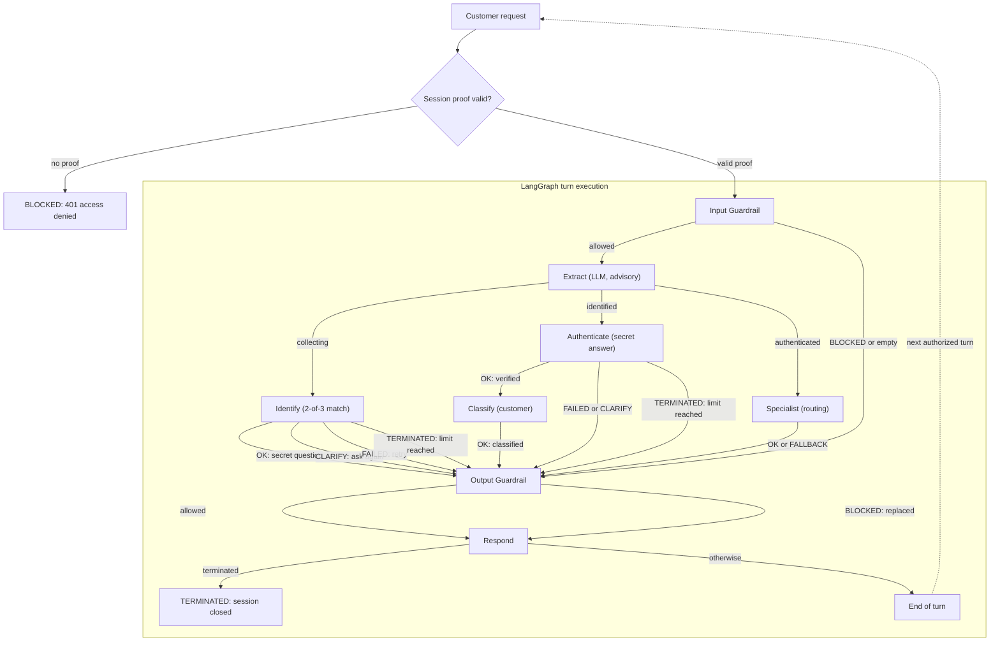

# 🤖 Personal Banking Support Agent

## Overview

This personal project implements a production-oriented, multi-agent banking customer support system. It explores how deterministic verification and agent orchestration can work together safely. Instead of forcing callers through endless phone menus, a small team of cooperating AI agents identifies the caller, classifies their relationship with the bank, and routes them to the right support destination-safely and deterministically.

The system is exposed as a FastAPI service and orchestrated with LangGraph. All security-critical decisions (identity matching, secret-answer verification, customer classification, and support routing) are implemented as deterministic, unit-tested Python logic. The LLM is used only for natural-language understanding and intent classification, never for authentication or authorization decisions.

## Agent Team

| Agent | Responsibility | Implemented in |
|-------|----------------|----------------|
| 👋 **Greeter** | Starts the conversation, collects identifying details, and verifies the caller's identity. | `src/banking_support/core/matching.py`, `src/banking_support/core/verification.py`, `src/banking_support/agents/nodes.py` |
| 🛡️ **Bouncer** | Classifies an authenticated caller as Premium, Regular, or Non-Customer. | `src/banking_support/core/classification.py` |
| 📞 **Specialist** | Routes authenticated requests to the appropriate support department (standard, premium, or specialist such as yacht insurance). | `src/banking_support/core/routing.py` |
| 📜 **Guardrails** | Enforces safety and policy: blocks prompt injection, pre-authentication data requests, unsupported commitments, and privacy violations. | `src/banking_support/services/guardrails_service.py`, input/output guardrail nodes |
| 🎙️ **Voice Interface** | Optional STT/TTS adapters that convert spoken input to text and approved replies to speech without duplicating banking logic. | `src/banking_support/voice/` |

## Conversation History

The assistant remembers relevant context across multiple messages within a single customer session:

- **Session-scoped history**: Each conversation has a unique identifier. History never leaks between sessions.
- **Context-aware agents**: The Greeter, Specialist, and Advanced Guardrails can use recent conversation context to interpret follow-up messages and clarification replies.
- **Secure by default**: Session identifiers are treated as untrusted inputs; authentication state is always derived from deterministic verification, not from conversation text.
- **Privacy**: Sensitive values (names, phones, IBANs, secret answers) are pattern-redacted before persistence, and known customer identifiers are redacted once a match identifies the customer. Conversation checkpoints and in-memory state still require production-grade storage controls.
- **Bounded context**: History is truncated to a configurable limit so that memory usage and LLM context costs do not grow indefinitely.
- **Lifecycle**: Customers can start, continue, and explicitly reset a conversation. Reset clears history and invalidates trusted authentication state.

## Voice Interface

Customers can also interact with the assistant using spoken messages. The voice layer is optional and disabled by default; it reuses the existing text-based workflow and security controls.

- **Speech-to-text (STT)**: Audio recordings are transcribed and the resulting text enters the same status-driven, per-turn workflow as typed messages.
- **Text-to-speech (TTS)**: Approved assistant replies can be converted into spoken audio when enabled.
- **Security first**: A voice recording or its transcription is never treated as proof of identity. Authentication and classification remain deterministic and unchanged.
- **Guardrails**: Input Guardrails evaluate transcribed text; output Guardrails block unsafe replies from being spoken.
- **Mixed-mode conversations**: Customers can switch between text and voice within the same session without losing context.
- **Testability**: Fake STT/TTS adapters let the full suite run without API credentials.

Enable voice by setting `VOICE_ENABLED=true` (and optionally `VOICE_STT_ENABLED=true`, `VOICE_TTS_ENABLED=true`). See `.env.example` for all voice settings.

## Architecture

The system has three complementary views: a project-level system diagram, a high-level
component map, and a detailed multi-turn workflow. All are maintained as Mermaid source so
they render directly on GitHub and stay reviewable in pull requests. Start with the
[System Architecture Diagram](docs/system-diagram.md) for the system-level view, then use
the views below for component and turn-level detail. The detailed security boundaries,
workflow rationale, and maintenance instructions live in
[`docs/architecture.md`](docs/architecture.md). For diagram updates, see
[maintenance and preview](docs/architecture.md#maintenance-and-preview).

### Architecture Overview

This view shows components, trust boundaries, and dependencies. It does not imply
that every agent executes on every request; agent selection is status-driven and
is shown in the workflow below. Solid arrows are primary paths, dashed arrows are
optional integrations or supporting calls.

```mermaid
flowchart TB
    subgraph Interfaces["Interfaces"]
        text_client["Text API client"]
        voice_adapters["Voice adapters (STT/TTS, optional)"]
        session_api["Session create or reset"]
    end

    subgraph Service["FastAPI service boundary"]
        text_handler["Text turn handler"]
        voice_handler["Voice turn handler (optional)"]
        session_gate["Session-ownership gate"]
        deny["401 access denied"]
    end

    subgraph Orchestration["LangGraph orchestration"]
        workflow["Per-turn workflow"]
        input_guard["Input Guardrail"]
        output_guard["Output Guardrail"]
    end

    subgraph Agents["Agent responsibilities"]
        greeter_agent["Greeter"]
        bouncer_agent["Bouncer"]
        specialist_agent["Specialist"]
    end

    subgraph Deterministic["Deterministic business logic"]
        matching["2-of-3 identity matching"]
        secret["Secret-answer verification"]
        classification["Customer classification"]
        routing["Support routing"]
        proof["Session-proof verification"]
    end

    subgraph State["State and session management"]
        history["Conversation history and checkpoint"]
        session_store["Session ownership store"]
    end

    subgraph External["External services and configuration"]
        llm["LLM provider (optional in tests)"]
        speech["Speech provider (optional)"]
        config["Environment configuration"]
    end

    response["Customer response"]

    text_client --> text_handler
    voice_adapters -.-> voice_handler
    session_api --> session_gate
    text_handler --> session_gate
    voice_handler -.-> session_gate
    session_gate -->|authorized| workflow
    session_gate -->|denied| deny
    workflow --> input_guard
    workflow --> output_guard
    workflow -.-> greeter_agent
    workflow -.-> bouncer_agent
    workflow -.-> specialist_agent
    greeter_agent -.-> matching
    greeter_agent -.-> secret
    bouncer_agent -.-> classification
    specialist_agent -.-> routing
    session_gate -.-> proof
    proof -.-> session_store
    workflow -.-> history
    greeter_agent -.-> llm
    specialist_agent -.-> llm
    voice_handler -.-> speech
    workflow -.-> config
    llm -.-> config
    speech -.-> config
    output_guard --> response

    classDef interface fill:#E7F0FF,stroke:#1F4E8C,color:#1F2937
    classDef service fill:#E8F5E9,stroke:#1A7F37,color:#1F2937
    classDef control fill:#FFF4D6,stroke:#8A6100,color:#1F2937
    classDef agent fill:#F3E8FF,stroke:#6B21A8,color:#1F2937
    classDef deterministic fill:#DDF4E4,stroke:#1A7F37,color:#1F2937
    classDef state fill:#E0F2F1,stroke:#0F766E,color:#1F2937
    classDef external fill:#F1F5F9,stroke:#475569,color:#1F2937
    classDef blocked fill:#FFE2E0,stroke:#B42318,color:#1F2937
    classDef success fill:#DDF4E4,stroke:#1A7F37,color:#1F2937

    class text_client,voice_adapters,session_api interface
    class text_handler,voice_handler,session_gate service
    class workflow,input_guard,output_guard control
    class greeter_agent,bouncer_agent,specialist_agent agent
    class matching,secret,classification,routing,proof deterministic
    class history,session_store state
    class llm,speech,config external
    class deny blocked
    class response success
```



### Multi-Agent Workflow

The workflow is stateful and spans multiple turns. A unique identity match ends
the current turn with a secret question; the answer is verified on the next turn.
Classification runs immediately after successful verification, while specialist
routing runs on later authenticated turns. Voice transcriptions enter this same
workflow as ordinary text. The session-ownership gate runs before LangGraph.



Outcome labels are explicit: `OK` means progress or a successful reply,
`BLOCKED` means refused or denied, `CLARIFY` means more information is needed,
`FAILED` means a safe retry or fallback, and `TERMINATED` means the session is
closed. The declared `terminated` graph node is not drawn because it is not
reached through normal execution; termination replies still pass through the
Output Guardrail. See the [workflow consistency
table](docs/architecture.md#workflow-consistency) for all nodes and unreachable
paths.

## Quickstart

### Setup

Requires **Python 3.12+** and [uv](https://docs.astral.sh/uv/).

```bash
uv sync --locked                     # create venv from the committed lockfile
cp .env.example .env                 # leave GROQ_API_KEY empty for offline runs
```

> **Live provider note**: an empty `GROQ_API_KEY` is valid for the offline test
> suite, which injects deterministic fake adapters. The service still starts
> without a key, but the manual identity flow below requires a real provider
> key because the default fake extractor has no scripted turns.

> **Note on example data**: the business-requirement example shows illustrative values (`phone: +1122334455`). The project's seed dataset uses a different, valid phone number for the demo customer Lisa. The example values are not required to match the seed data exactly.

### Run the service

```bash
uv run uvicorn banking_support.api.app:create_app --factory --port 8000
```

Interactive API docs: http://localhost:8000/docs

Liveness check (no session proof required):

```bash
curl -fsS http://localhost:8000/health
# {"status":"ok"}
```

### Run with Docker

The image installs locked runtime dependencies only and exposes the same FastAPI
application on port 8000.

```bash
docker build -t banking-support .
docker run --rm -p 8000:8000 banking-support
curl -fsS http://localhost:8000/health
```

The image defines a `HEALTHCHECK` against `/health`; pass configuration with
`--env-file .env` only when you need live provider access.

### Run tests and quality gates

The offline suite uses scripted fake LLM and speech adapters — no API key and no
network required.

```bash
uv run pytest                              # full suite; live tests skip without credentials
uv run pytest -m "not live_llm and not live_speech" \
  --cov=src/banking_support --cov-branch --cov-report=term-missing --cov-fail-under=80
uv run pytest -m live_llm                  # run live-LLM tests (requires GROQ_API_KEY)
uv run pytest -m live_speech               # run live speech tests (requires GROQ_API_KEY)
uv run mypy src
uv run ruff check src tests
uv run ruff format --check src tests
uv export --locked --format requirements.txt --no-editable --no-emit-project \
  --output-file /tmp/banking-support-requirements.txt
uv run pip-audit --strict -r /tmp/banking-support-requirements.txt
```

The offline CI quality gate requires at least 80% line coverage for `src/banking_support`.
Live-provider markers remain excluded from that job and are only run in separately gated jobs.
Coverage failures are merge-blocking; dependency-audit failures are also merge-blocking unless
the exception owner, rationale, and remediation date are documented in the security review.

### Manual end-to-end example

Every session-scoped request must carry the ownership proof returned when the
session is created. The conversation identifier alone is **not** sufficient:
any request without a valid `X-Session-Proof` header (or with a missing,
malformed, unknown, or inactive proof) is rejected uniformly with
`401 {"detail": "Session access denied."}` and does not change any session state.

```bash
# Check service liveness (no session proof required).
curl -fsS localhost:8000/health

# Create a session and capture its ownership proof from the response header.
curl -s -D /tmp/conv.headers -o /tmp/conv.json -X POST localhost:8000/conversations
CID=$(jq -r .conversation_id /tmp/conv.json)
PROOF=$(awk 'tolower($1)=="x-session-proof:"{print $2}' /tmp/conv.headers | tr -d '\r')
PROOF_HEADER="X-Session-Proof: $PROOF"

# Greeter: provide identifying attributes
curl -s -X POST localhost:8000/conversations/$CID/messages \
  -H 'Content-Type: application/json' -H "$PROOF_HEADER" \
  -d '{"text": "Hi, I am Lisa, my phone is +14155552671"}' | jq

# Greeter: answer the secret question
curl -s -X POST localhost:8000/conversations/$CID/messages \
  -H 'Content-Type: application/json' -H "$PROOF_HEADER" \
  -d '{"text": "It is Yoda"}' | jq

# Specialist: ask for yacht insurance
curl -s -X POST localhost:8000/conversations/$CID/messages \
  -H 'Content-Type: application/json' -H "$PROOF_HEADER" \
  -d '{"text": "I need help with my yacht insurance"}' | jq

# Voice example (requires VOICE_ENABLED=true and an STT/TTS provider or fake adapters)
curl -s -X POST "localhost:8000/conversations/$CID/voice/messages" \
  -H "$PROOF_HEADER" \
  -F "audio=@sample.wav" \
  -F "enable_tts=true" | jq

# Reset clears the session state and rotates the proof; reuse the new header
# value returned by this call for any subsequent requests.
curl -s -D /tmp/reset.headers -X POST localhost:8000/conversations/$CID/reset \
  -H "$PROOF_HEADER" | jq
```

## CI/CD

The project uses GitHub Actions.

- **Standard CI** (`quality` job) runs on every push to `main`, `master`, `feature/*`, or `fix/*` and on every pull request. It installs from `uv.lock` with `uv sync --locked`, runs linting, formatting, typing, and the offline test suite (`not live_llm and not live_speech`). It does **not** use any LLM API key and costs nothing.
- **Live-LLM validation** (`live-llm` job) runs only on pull requests from the same repository. It uses the `GROQ_API_KEY` secret and is capped at a small number of provider calls.
- **Container smoke test** (`Container` workflow) builds the multi-stage image, verifies UID `10001`, starts the image, polls `/health`, prints container logs on failure, and always cleans up. There is no deployment target or deployment workflow.
- **Dependency audit** (`Dependency Audit` workflow) audits the locked environment on dependency-changing pull requests and weekly. `pip-audit --strict` reports actionable vulnerabilities; update `pyproject.toml` and regenerate `uv.lock` with `uv lock` when remediation is available.

### Delivery maintenance

The production image contains only the locked runtime venv and application source. Build-only tools,
tests, specifications, documentation, caches, credentials, and local artifacts are excluded by
`.dockerignore`. Dependabot opens grouped updates for the Python/uv lockfile, GitHub Actions, and
the Docker base image. Review dependency-audit findings promptly; any temporary exception must name
an owner and a dated remediation plan.

### Optional GitHub setup

1. Go to **Settings → Secrets and variables → Actions** and optionally add a repository secret named `GROQ_API_KEY` with your real Groq key. Without it, live-provider tests skip.
2. Branch protection is **conditional**: GitHub does not offer branch protection or rulesets for free private repositories. If your repository visibility and plan support it, protect `main` (and `master` if used) and require the `quality` status check. Otherwise, rely on the CI workflow and review process.

## Production readiness

The application is designed as a deployable baseline with typed configuration,
locked dependencies, deterministic authentication, redaction, health checks,
container builds, and CI. The following operational boundaries are intentional
and should be addressed before running it with real customer data at scale:

- **State persistence**: sessions, conversation checkpoints, history, and
  customer records live in the process. A restart or multiple workers lose
  sessions. A shared checkpointer/session store and a database are required
  before horizontal scaling.
- **Edge protections**: the API does not rate-limit session creation or message
  turns, lock out repeated secret-answer attempts globally, or enforce request
  quotas. Deploy behind a gateway that provides TLS, request-size limits, and
  rate limiting.
- **Provider fallbacks**: when provider credentials are absent, deterministic
  fake LLM and speech adapters keep the offline suite and startup working. They
  are not a substitute for live provider integration in production.
- **Container hardening**: the image is a smoke-tested build target. Add a
  non-root user, image scanning, and an SBOM before production use.
