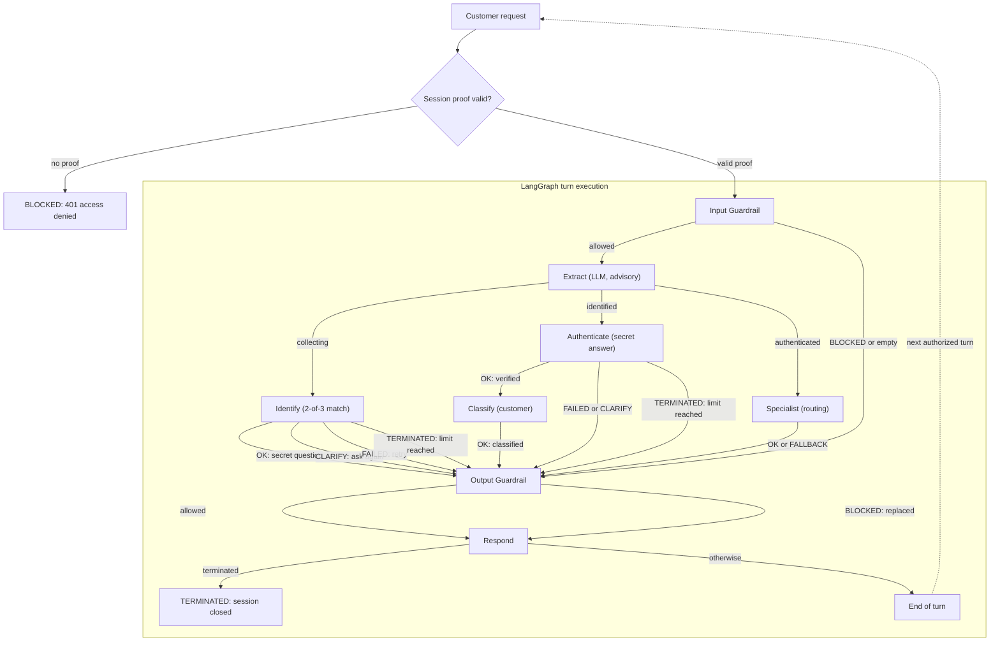

# AgentFlow AI — Secure Multi-Agent Customer Support

An independent AI engineering project exploring how multiple specialized agents can collaborate to deliver secure, context-aware customer support.

Built using **Python, FastAPI, LangGraph, React, and TypeScript**, the platform combines natural-language understanding with deterministic identity verification, authorization, customer classification, and intelligent request routing.

The project emphasizes responsible AI engineering, workflow orchestration, automated testing, and measurable agent reliability.

**Key engineering principles:** Security by design · Human oversight · Observability · Evaluation-driven development

---

## What this project demonstrates

- **Multi-agent orchestration** with a stateful LangGraph workflow, explicit routing, and guardrails at the input and output boundaries.
- **Deterministic security** for identity matching, secret-answer verification, session ownership, customer classification, and support routing. The LLM is advisory only.
- **Typed backend contracts** with FastAPI and Pydantic, including sanitized response models that never return PII.
- **Full-stack delivery** with a React + TypeScript client that renders the conversation and live, sanitized agent telemetry.
- **Observability** through structured logs, traces, bounded conversation history, and explicit turn state.
- **Evaluation-driven engineering** with a large offline test suite, coverage gates, static typing, linting, and CI.

## Reference scenario

The repository ships with a **banking support demo adapter**. It provides a small seed dataset and a concrete identity, authorization, classification, and routing scenario so the workflow can be exercised end to end.

The platform framing is domain-agnostic: the banking adapter is the current reference implementation, not a limit on the architecture. The Python package remains named `healthcare_support` because it contains that demo domain.

## Architecture

### Architecture Overview

This view shows components, trust boundaries, and dependencies. It does not imply that every agent executes on every request; agent selection is status-driven and is shown in the workflow below. Solid arrows are primary paths, dashed arrows are optional integrations or supporting calls.

```mermaid
flowchart TB
    subgraph Interfaces["Interfaces"]
        web_client["React + TypeScript client"]
        text_client["Text API client"]
        voice_adapters["Voice adapters (STT/TTS, optional)"]
        session_api["Session create or reset"]
    end

    subgraph Service["FastAPI service boundary"]
        text_handler["Text turn handler"]
        voice_handler["Voice turn handler (optional)"]
        session_gate["Session-ownership gate"]
        deny["401 access denied"]
    end

    subgraph Orchestration["LangGraph orchestration"]
        workflow["Per-turn workflow"]
        input_guard["Input Guardrail"]
        output_guard["Output Guardrail"]
    end

    subgraph Agents["Agent responsibilities"]
        greeter_agent["Greeter"]
        bouncer_agent["Bouncer"]
        specialist_agent["Specialist"]
    end

    subgraph Deterministic["Deterministic business logic"]
        matching["2-of-3 identity matching"]
        secret["Secret-answer verification"]
        classification["Customer classification"]
        routing["Support routing"]
        proof["Session-proof verification"]
    end

    subgraph State["State and session management"]
        history["Conversation history and checkpoint"]
        session_store["Session ownership store"]
    end

    subgraph External["External services and configuration"]
        llm["LLM provider (optional in tests)"]
        speech["Speech provider (optional)"]
        config["Environment configuration"]
    end

    response["Customer response"]

    web_client --> text_handler
    text_client --> text_handler
    voice_adapters -.-> voice_handler
    session_api --> session_gate
    text_handler --> session_gate
    voice_handler -.-> session_gate
    session_gate -->|authorized| workflow
    session_gate -->|denied| deny
    workflow --> input_guard
    workflow --> output_guard
    workflow -.-> greeter_agent
    workflow -.-> bouncer_agent
    workflow -.-> specialist_agent
    greeter_agent -.-> matching
    greeter_agent -.-> secret
    bouncer_agent -.-> classification
    specialist_agent -.-> routing
    session_gate -.-> proof
    proof -.-> session_store
    workflow -.-> history
    greeter_agent -.-> llm
    specialist_agent -.-> llm
    voice_handler -.-> speech
    workflow -.-> config
    llm -.-> config
    speech -.-> config
    output_guard --> response

    classDef interface fill:#E7F0FF,stroke:#1F4E8C,color:#1F2937
    classDef service fill:#E8F5E9,stroke:#1A7F37,color:#1F2937
    classDef control fill:#FFF4D6,stroke:#8A6100,color:#1F2937
    classDef agent fill:#F3E8FF,stroke:#6B21A8,color:#1F2937
    classDef deterministic fill:#DDF4E4,stroke:#1A7F37,color:#1F2937
    classDef state fill:#E0F2F1,stroke:#0F766E,color:#1F2937
    classDef external fill:#F1F5F9,stroke:#475569,color:#1F2937
    classDef blocked fill:#FFE2E0,stroke:#B42318,color:#1F2937
    classDef success fill:#DDF4E4,stroke:#1A7F37,color:#1F2937

    class web_client,text_client,voice_adapters,session_api interface
    class text_handler,voice_handler,session_gate service
    class workflow,input_guard,output_guard control
    class greeter_agent,bouncer_agent,specialist_agent agent
    class matching,secret,classification,routing,proof deterministic
    class history,session_store state
    class llm,speech,config external
    class deny blocked
    class response success
```



The [System Architecture Diagram](docs/system-diagram.md) provides the system-level backend view of channels, service boundaries, deterministic controls, state, and external dependencies. Deeper component and workflow details live in [docs/architecture.md](docs/architecture.md). For diagram updates, see [maintenance and preview](docs/architecture.md#maintenance-and-preview).

### Multi-Agent Workflow

The workflow is stateful and spans multiple turns. A unique identity match ends the current turn with a secret question; the answer is verified on the next turn. Classification runs immediately after successful verification, while specialist routing runs on later authenticated turns. Voice transcriptions enter this same workflow as ordinary text. The session-ownership gate runs before LangGraph.



Outcome labels are explicit: `OK` means progress or a successful reply, `BLOCKED` means refused or denied, `CLARIFY` means more information is needed, `FAILED` means a safe retry or fallback, and `TERMINATED` means the session is closed. See the [workflow consistency table](docs/architecture.md#workflow-consistency) for all nodes and unreachable paths.

### Frontend

The `frontend/` application is a Vite + React + TypeScript client. It provides:

- A session-scoped support conversation.
- A live workflow timeline for identity, authorization, classification, and routing.
- Sanitized telemetry with no PII and no exposure of the session proof.
- A responsive dark interface with accessible focus states and reduced-motion support.

During development, Vite proxies `/api` to `http://127.0.0.1:8000`, so no browser CORS configuration is needed. The backend also exposes a configurable `CORS_ALLOWED_ORIGINS` setting for direct cross-origin deployments.

## Agent team

| Stage | Responsibility | Implemented in |
|-------|----------------|----------------|
| **Greeter** | Starts the conversation, collects identifying details, and verifies the caller's identity. | `src/healthcare_support/core/matching.py`, `src/healthcare_support/core/verification.py`, `src/healthcare_support/agents/nodes.py` |
| **Bouncer** | Classifies an authenticated caller for the banking demo. | `src/healthcare_support/core/classification.py` |
| **Specialist** | Routes authenticated requests to the appropriate support destination. | `src/healthcare_support/core/routing.py` |
| **Guardrails** | Blocks prompt injection, pre-authentication data requests, unsupported commitments, and privacy violations. | `src/healthcare_support/services/guardrails_service.py`, input/output guardrail nodes |
| **Voice interface** | Optional STT/TTS adapters that reuse the text workflow and security controls. | `src/healthcare_support/voice/` |

## Security model

- **The model never grants access.** Identity matching, secret-answer verification, session ownership, classification, and routing are deterministic Python logic with focused tests.
- **Session ownership is explicit.** Every session-scoped request must carry the `X-Session-Proof` header returned when the session is created. The conversation identifier alone is not sufficient.
- **Responses are sanitized.** The API response schema deliberately contains no PII fields.
- **History is bounded and redacted.** Sensitive values are pattern-redacted before persistence, and history is truncated to a configurable limit.
- **Guardrails sit at both boundaries.** Input checks run before model calls; output checks run before a reply is returned or spoken.
- **Voice is not authentication.** A recording or transcription never proves identity.

## Quickstart

### Prerequisites

- Python 3.12+
- [uv](https://docs.astral.sh/uv/)
- Node.js 22.12+
- npm

### 1. Start the backend

```bash
uv sync --locked
cp .env.example .env                 # leave GROQ_API_KEY empty for offline runs
uv run uvicorn healthcare_support.api.app:create_app --factory --port 8000
```

- Interactive API docs: http://localhost:8000/docs
- Liveness check: `curl -fsS http://localhost:8000/health`

> **Live provider note**: an empty `GROQ_API_KEY` is valid for the offline test suite, which injects deterministic fake adapters. The service still starts without a key, but a full manual identity flow needs a real provider key because the default fake extractor has no scripted turns.

### 2. Start the frontend

```bash
cd frontend
npm ci
npm run dev
```

Open http://localhost:5173. The browser client defaults to `/api`, and the dev server proxies `/api` to the backend on port 8000.

To call a different API origin directly:

```bash
VITE_API_BASE_URL=http://localhost:8000 npm run dev
```

Then add the frontend origin to the backend's `CORS_ALLOWED_ORIGINS`.

The production build uses the same `/api` default. `npm run preview` mirrors the dev proxy locally; a real deployment must route `/api/*` to the backend root.

#### Troubleshooting a 404 on session start

A 404 on `POST /conversations` means the browser reached the static frontend host instead of the API gateway. Confirm that `VITE_API_BASE_URL` is empty or set to a reachable API origin, that the dev/preview server is running, and that production routes `/api/*` to the backend. The backend's own routes stay at `/conversations`.

### 3. Run with Docker

The backend image installs locked runtime dependencies only and exposes FastAPI on port 8000.

```bash
docker build -t agentflow-ai .
docker run --rm -p 8000:8000 agentflow-ai
curl -fsS http://localhost:8000/health
```

The frontend is a static build (`npm run build`) and can be served by any static host or reverse proxy. In production, route `/api` to the backend and keep the `X-Session-Proof` header exposed.

### 4. Run tests and quality gates

The offline suite uses scripted fake LLM and speech adapters. No API key and no network are required.

```bash
uv run pytest
uv run pytest -m "not live_llm and not live_speech" \
  --cov=src/healthcare_support --cov-branch --cov-report=term-missing --cov-fail-under=80
uv run pytest -m live_llm                  # requires GROQ_API_KEY
uv run pytest -m live_speech               # requires GROQ_API_KEY
uv run mypy src
uv run ruff check src tests
uv run ruff format --check src tests
cd frontend && npm test
cd frontend && npm run build
```

The offline CI quality gate requires at least 80% line coverage for `src/healthcare_support`.

### 5. Dependency updates and lockfile troubleshooting

`pyproject.toml` and `uv.lock` must stay in sync. `uv sync --locked` intentionally fails when they drift, which happens when a dependency version range changes without regenerating the lock. To recover:

```bash
uv lock
uv sync --locked
```

Commit the regenerated `uv.lock` together with the `pyproject.toml` change.

When Dependabot or a manual update raises a version requirement, run `uv lock` and include both files in the same pull request. Locked installation and the strict dependency audit remain required gates; do not replace them with an unlocked install.

## Manual API example

Every session-scoped request must carry the ownership proof returned when the session is created. A missing, malformed, unknown, or inactive proof is rejected uniformly with `401 {"detail": "Session access denied."}`.

```bash
# Check service liveness (no session proof required).
curl -fsS localhost:8000/health

# Create a session and capture its ownership proof from the response header.
curl -s -D /tmp/conv.headers -o /tmp/conv.json -X POST localhost:8000/conversations
CID=$(jq -r .conversation_id /tmp/conv.json)
PROOF=$(awk 'tolower($1)=="x-session-proof:"{print $2}' /tmp/conv.headers | tr -d '\r')
PROOF_HEADER="X-Session-Proof: $PROOF"

# Greeter: provide identifying attributes.
curl -s -X POST localhost:8000/conversations/$CID/messages \
  -H 'Content-Type: application/json' -H "$PROOF_HEADER" \
  -d '{"text": "Hi, I am Lisa, my phone is +14155552671"}' | jq

# Greeter: answer the secret question.
curl -s -X POST localhost:8000/conversations/$CID/messages \
  -H 'Content-Type: application/json' -H "$PROOF_HEADER" \
  -d '{"text": "It is Yoda"}' | jq

# Specialist: ask a support question.
curl -s -X POST localhost:8000/conversations/$CID/messages \
  -H 'Content-Type: application/json' -H "$PROOF_HEADER" \
  -d '{"text": "I need help with a card payment"}' | jq

# Reset clears session state and rotates the proof.
curl -s -D /tmp/reset.headers -X POST localhost:8000/conversations/$CID/reset \
  -H "$PROOF_HEADER" | jq
```

## Project structure

```text
src/healthcare_support/   FastAPI service, LangGraph workflow, banking demo adapter
frontend/              React + TypeScript client (Vite)
tests/                 Contract, integration, and unit tests
docs/                  Architecture, system diagram, and maintenance notes
scripts/               Local verification helpers
```

## CI/CD

- **Quality** runs linting, formatting, strict typing, and the offline test suite with an 80% coverage gate.
- **Frontend** installs from `frontend/package-lock.json` and runs the TypeScript production build.
- **Live LLM** runs only on same-repository pull requests when `GROQ_API_KEY` is configured.
- **Container** builds the backend image, verifies the non-root UID, starts it, and polls `/health`.
- **Dependency audit** audits the locked Python environment on dependency-changing pull requests and weekly. Dependabot covers Python, npm, GitHub Actions, and Docker updates.

## Production readiness

The application is a deployable baseline with typed configuration, locked dependencies, deterministic authentication, redaction, health checks, container builds, CI, and a typed frontend. The following boundaries are intentional and should be addressed before running with real customer data at scale:

- **State persistence**: sessions, checkpoints, history, and customer records live in process memory. A restart or multiple workers lose sessions. Use a shared checkpointer and database before horizontal scaling.
- **Edge protections**: add rate limiting, request quotas, TLS, and global lockout controls at a gateway.
- **Provider fallbacks**: fake adapters keep offline tests and startup working; they are not a production substitute for live provider integration.
- **Container hardening**: add image scanning and an SBOM, and keep the non-root runtime constraint.
- **Frontend deployment**: serve the static build over HTTPS and keep the API proof header exposed through the chosen reverse proxy.

## License

Apache-2.0. See [LICENSE](LICENSE).
