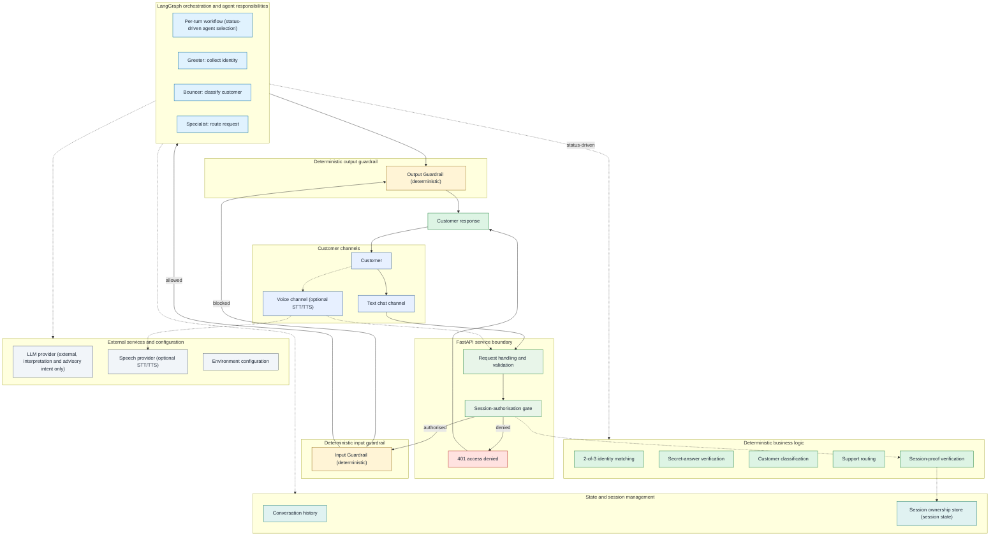

# System Architecture Diagram

This page presents the project-level system view for AgentFlow AI. The banking support flow is the reference demo adapter; the service boundaries and deterministic controls are domain-agnostic.
It shows how customers reach the service, where authorisation and deterministic security
decisions happen, which responsibilities run inside the system, and which services remain
external. It complements the detailed architecture overview and multi-agent workflow rather
than replacing them: per-turn transitions and detailed component behaviour remain in the
[detailed architecture](architecture.md) and the
[README workflow view](../README.md#multi-agent-workflow).

## System Diagram



## How to Read the Diagram

- **Solid arrows** show primary request and response paths. **Dashed arrows** show optional
  voice handling, external calls, shared state, or supporting verification.
- **Channels** are the customer-facing ways into the system. Voice is optional and uses the
  same authorisation and security controls as text; it is not a separate business path.
- **Service boundary** is the first trust boundary. Every request passes through request
  handling and the session-authorisation gate before orchestration starts. A denied request
  returns a uniform `401` response and does not reach the workflow.
- **Orchestration** selects the responsible agent for the current turn based on persisted
  conversation status. Not every agent runs on every request.
- **Deterministic business logic and guardrails** contains the decisions that must be
  reproducible: identity matching, secret-answer verification, customer classification,
  support routing, session-proof verification, and input/output guardrails.
- **State** is system-managed. Conversation history and session ownership are not agent
  responsibilities.
- **External services** are outside the security-critical boundary. The language model is
  used for interpretation and advisory intent classification only. Voice and speech
  providers are optional.

## Security Boundaries

| Boundary | What is deterministic | What the language model may do |
|----------|-----------------------|-------------------------------|
| Session ownership | The presented session proof is verified against the stored proof before graph or history state is touched. | Nothing. It never authorises session access. |
| Identity | At least two of name, phone, and IBAN must match after normalisation. | Extract candidate attributes for the conversation. |
| Secret answer | The normalised answer is verified against the registered answer with attempt limits. | Extract the answer text; it never decides whether the answer is correct. |
| Classification | The customer is classified from the trusted repository record. | Provide advisory intent only. |
| Routing | Routing requires authenticated status, trusted classification, and validated intent. | Suggest intent; it never selects a privileged destination. |
| Guardrails | Input and output policy checks are deterministic and every customer-facing reply passes through the output guardrail. | Nothing. It never overrides a guardrail decision. |

The language model must never perform authentication or authorisation, classify an account
authoritatively, or choose a privileged support destination. Deterministic code owns every
security decision.

## Relationship to Other Views

| View | What it answers | Where to find it |
|------|-----------------|------------------|
| **System Architecture Diagram** (this page) | What the whole system contains, which boundaries it crosses, and which dependencies are external. | This page. |
| **Architecture Overview** | Which components, trust boundaries, and optional integrations exist in more detail. | [README: Architecture](../README.md#architecture) |
| **Multi-Agent Workflow** | Which nodes and conditional transitions run on a given turn, including blocked, clarification, failure, and termination outcomes. | [README: Multi-Agent Workflow](../README.md#multi-agent-workflow) |
| **Detailed Architecture** | Component responsibilities, request lifecycle, declared-unreachable paths, and maintenance rationale. | [Detailed architecture](architecture.md) |

## Maintenance and Preview

The authoritative source for the system-level view is
[`docs/system-diagram.md`](system-diagram.md). Do not duplicate this Mermaid block in the
README or in [`docs/architecture.md`](architecture.md). The repository does not use a
diagram generator, screenshot, or binary image for this view; the committed Mermaid source
is authoritative. If a future generator is introduced, its output MUST match the committed source.

Preview the diagram on GitHub or with a GitHub-compatible Markdown/Mermaid preview such as
the VS Code Markdown preview. Check both light and dark themes and a narrow pane before
merging.

When a component, dependency, boundary, or security responsibility changes:

1. Update the Mermaid block in `docs/system-diagram.md`.
2. Update the explanation or security boundaries above if the meaning changed.
3. Update the Diagram Map or links in [`docs/architecture.md`](architecture.md) if
   navigation changed.
4. Update [`tests/unit/test_system_diagram_docs.py`](../tests/unit/test_system_diagram_docs.py)
   if the expected content changed.
5. Preview the page and run the focused documentation test:

   ```bash
   uv run pytest tests/unit/test_system_diagram_docs.py -q
   ```

6. Run the full quality gates:

   ```bash
   uv run pytest
   uv run mypy src && uv run ruff check src
   ```

## Links

- [README architecture](../README.md#architecture)
- [README multi-agent workflow](../README.md#multi-agent-workflow)
- [Detailed architecture](architecture.md)
- [System diagram documentation test](../tests/unit/test_system_diagram_docs.py)
